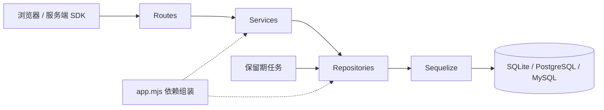

# Visora 后端架构

Visora 采用 **模块化单体 + 分层依赖 + Sequelize ORM**。当前一个进程提供管理 API、采集 API、统计查询、前端静态资源和保留期清理；业务边界独立，后续可以抽出采集进程、查询服务或后台任务。

## 目录与职责

```text
server/
├── public/tracker.js            浏览器采集 SDK，独立于管理前端
├── src/
│   ├── index.mjs                进程入口：启动监听、处理退出信号
│   ├── app.mjs                  组装入口：建立资源、注入依赖、注册模块、释放资源
│   ├── config.mjs               环境配置解析、默认值和校验
│   ├── cli/migrate.mjs          独立迁移命令，不启动 HTTP 和定时任务
│   ├── plugins/
│   │   ├── http.mjs             Cookie、限流、异常映射、HTTP 响应头
│   │   └── web.mjs              采集脚本、前端静态资源、SPA 回退
│   ├── shared/
│   │   ├── errors.mjs           无 HTTP 依赖的业务错误
│   │   └── crypto.mjs           密钥及会话 token 哈希
│   ├── infrastructure/database/
│   │   ├── connection.mjs      Sequelize 连接、事务、连接参数、数据库关闭
│   │   ├── models.mjs          表、字段、关联和索引映射
│   │   ├── migrate.mjs         有序迁移执行与数据库版本检查
│   │   └── migrations/
│   │       ├── 001-initial.mjs 初始关系表，兼容早期 Visora SQLite 表
│   │       └── 002-event-day.mjs 统一 UTC 日期字段及已有数据回填
│   ├── modules/
│   │   ├── auth/               登录、会话、管理员访问控制
│   │   ├── projects/           项目、来源白名单、采集密钥
│   │   ├── ingestion/          浏览器和服务端采集、规范化、幂等写入
│   │   └── analytics/          指标、趋势、排行、明细和 CSV
│   └── jobs/retention.mjs       清理过期事件与会话，支持优雅停止
└── test/                       API、迁移、配置隔离的测试代码
```

模块内部按需要使用以下文件，不为凑层级创建空目录：

| 文件             | 职责                               | 可依赖                             |
| ---------------- | ---------------------------------- | ---------------------------------- |
| `routes.mjs`     | HTTP 输入、状态码、响应、认证 hook | 模块服务                           |
| `schemas.mjs`    | Zod 输入规则、筛选参数解析         | 通用业务错误                       |
| `service.mjs`    | 用例、授权规则、规范化、统计口径   | 注入的仓储、其他模块公开服务、时钟 |
| `repository.mjs` | ORM 查询、事务、持久化数据转换     | 注入的数据库及模型                 |
| 专用辅助文件     | 例如 CSV、UA 分类、认证 guard      | 所属模块需要的纯函数或公开服务     |



`app.mjs` 是依赖组装的唯一入口。路由不直接访问 ORM；服务不读取 `process.env`，不依赖 Fastify；仓储不接受 HTTP request/reply。跨模块调用通过注入服务进行，例如采集服务使用项目服务鉴权。当前统计仓储作为读取模型，可以读取项目与事件的组合结果；写入规则仍由所属模块负责。

时间通过 `clock` 注入，配置通过 `loadConfig` 注入，仓储通过构造函数注入。服务测试可以替换这些依赖而不启动 HTTP 或数据库。应用关闭时先等待后台清理结束，再关闭数据库连接。

## 数据模型与 ORM 边界

| 表                  | 用途                                          | 关键约束                                               |
| ------------------- | --------------------------------------------- | ------------------------------------------------------ |
| `projects`          | 项目、公开站点 ID、来源、服务端密钥哈希、启停 | `site_id`、`key_hash` 唯一                             |
| `events`            | 规范化后的访问与自定义事件                    | `(project_id, event_id)` 唯一；项目/时间与全局时间索引 |
| `sessions`          | 管理会话 token 哈希、有效期、密码指纹         | token 主键；过期时间索引                               |
| `settings`          | 实例级持久设置，含访客 HMAC 身份盐            | key 主键                                               |
| `schema_migrations` | 已完成迁移的版本和名称                        | version 主键                                           |

运行时代码通过 Sequelize 模型查询，JS 使用 camelCase，数据库保留 snake_case。聚合使用 ORM 的 `COUNT`、`DISTINCT`、`MAX` 和分组表达式。统计日期是写入时生成的 `YYYY-MM-DD` UTC 字段，避免 `strftime`、`DATE_FORMAT` 等特定数据库函数。数据库返回的 BIGINT/COUNT 字符串统一在仓储转换，保持现有 API 返回格式。

默认 SQLite 适合单实例和中小规模统计；关系库连接可配置为 PostgreSQL 或 MySQL，驱动已声明在后端依赖中。MySQL 新建表使用 `utf8mb4_bin`，避免大小写不同的事件 ID 被视为相同。SQL 方言差异限于数据库基础设施（例如 SQLite 的 WAL 参数），不散落在业务服务中。

事件批次先整体校验，再在事务内写入。单个进程内 SQLite 采集事务串行执行；PostgreSQL/MySQL 锁定对应项目行，使同项目并发重试能够准确返回 accepted/duplicates。数据库唯一索引作为最终去重约束。客户端重试必须沿用原 eventId。行锁使同项目写入串行化，超大流量项目未来应拆批处理或引入队列与聚合存储。

## 配置与版本迁移

完整环境变量示例在根目录 [`.env.example`](../.env.example)。连接配置与应用配置分别解析，迁移命令无需管理员密码。

| 配置                  | 含义                                                             |
| --------------------- | ---------------------------------------------------------------- |
| `VISORA_DATABASE`     | 默认 `./data/visora.sqlite`；只在没有远程 URL 时使用             |
| `VISORA_DATABASE_URL` | PostgreSQL/MySQL URL，需指定专用数据库；非空时优先于 SQLite 路径 |
| `VISORA_DB_SSL`       | 启用远程 TLS 并校验证书，默认 false                              |
| `VISORA_DB_CA_FILE`   | 可选 CA 文件；容器内路径需要额外挂载                             |
| `VISORA_AUTO_MIGRATE` | 未设置或空值时：SQLite 自动迁移，远程数据库仅检查版本            |

Visora 不创建远程数据库或用户。部署前准备独立的 Visora 数据库及权限，目标为 PostgreSQL 14+ / MySQL 8+；不要使用其他业务应用的库。URL 密码中的特殊字符需要百分号编码。`VISORA_DB_SSL=true` 使用 Node 信任库或提供的 CA 验证服务端证书。

在项目根目录执行迁移：

```sh
pnpm db:migrate
```

迁移命令只建立数据库连接、执行缺少的迁移并初始化必要设置，不监听端口、不清理业务数据。`schema_migrations` 保存已成功执行的版本；已执行迁移不可修改，后续变化新增编号文件，并在 `migrate.mjs` 的列表末尾注册。迁移使用固定的字段定义，不依赖未来可能变化的运行时模型。

不使用 `sequelize.sync({ alter: true })` 或 `force: true` 更新业务表。仅迁移记录表通过无破坏选项的 `sync()` 初始化，其余表和索引由显式迁移创建。

- SQLite/PostgreSQL 每次迁移和版本登记在同一个事务内。
- MySQL DDL 会隐式提交，因此迁移检查已有表、索引、字段，并支持未登记完成时重入。MySQL 迁移不承诺整次 DDL 原子回滚。
- 部署迁移由**单个进程**执行。当前迁移器没有分布式迁移锁；多副本应用设 `VISORA_AUTO_MIGRATE=false`，先完成独立迁移任务，再启动应用。
- 升级前备份；当前只提供向前迁移，恢复旧版本应恢复对应备份。应用拒绝运行于比代码更新的数据库版本或不连续的迁移记录。
- 切换连接 URL **不会搬运已有数据**。跨数据库搬迁需要独立导入流程；保持访客身份连续时须保留 `settings.identity_salt`。复制完整数据库时还需要重置事件自增序列。仅通过事件接口导入不会迁移项目配置和密钥。

## 模块之间的安全边界

管理接口使用管理员会话；变更请求验证来源。`auth` 和管理模块的 hook 限定在各自路由作用域，采集入口不会误依赖管理登录。

浏览器入口通过公开站点 ID 和精确 Origin 白名单选择项目；服务端入口通过项目密钥鉴权，项目 ID 由服务端确定。浏览器上传的时间和 UA 不作为可信来源，服务端上报可提交保留期内的历史事件。两种入口使用同一规范化和幂等写入流程。

服务端密钥只在创建或轮换时返回原文，数据库只存哈希。管理密码由部署配置提供，数据库会话只存密码指纹；修改密码并重启后撤销其他指纹的会话，恢复旧密码也不会复活旧会话。所有应用副本需要一致的密码及数据库配置。

访客/会话标识按项目隔离后 HMAC 保存，不存原始 IP、完整 UA、query/hash 或来源完整路径。统计 UV 是项目范围内身份去重；跨项目聚合不会尝试识别同一个自然人。

## 后续扩展示例

- **新增漏斗或转化率**：在 `analytics/schemas.mjs` 定义筛选，`service.mjs` 规定口径，`repository.mjs` 实现查询，在路由和前端接入。需要新表时同时增加迁移与模型。
- **新增组织、用户与角色**：增加 `modules/organizations`、`modules/users`；通过迁移引入 organization_id，并将租户范围加入所有仓储查询和服务授权。现在的项目隔离不是组织权限隔离。
- **新增消息队列采集**：保持统一事件输入协议，在采集服务和事件仓储间引入持久化 outbox/队列；消费端沿用幂等约束。HTTP 返回成功的语义需要相应定义为已持久接收或已入库。
- **更大数据量的查询**：先引入日级聚合或独立查询仓储，再按实际负载接入 ClickHouse。ClickHouse 不作为 Sequelize 方言直接替换；通过统计仓储实现相同读取契约，并保留关系库管理配置。
- **独立后台任务**：把 `jobs/retention.mjs` 移到 worker 入口，在多实例场景配置单调度者或分布式锁。当前 HTTP 限流是实例内计数，多实例需共享限流存储或在网关限流。

## 测试边界

后端测试入口为根目录 `pnpm test`。API 测试显式使用独立内存 SQLite；重启/旧版迁移测试使用系统临时目录。配置解析使用空环境，端到端服务也固定 SQLite，不会读取本机其他服务的数据库 URL。`node:sqlite` 仅在测试中创建旧版本迁移样本，运行时持久化全部使用 ORM。

本轮按要求未执行 ORM 改造后的测试、数据库迁移或构建，也未连接本机 PostgreSQL/MySQL。当前三个方言的配置与实现已写入代码，兼容性仍需后续在独立环境中验证。
